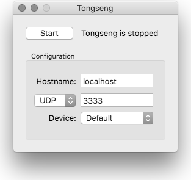

Tongseng
========

Tongseng is a [TUIO](http://tuio.org) multitouch tracker for Mac OS X touchpad devices. 
This application allows to use the internal trackpad (or alternatively an external magic trackpad or magic mouse) 
to send /tuio/2Dcur messages to your TUIO enabled multitouch application. 
It supports the TUIO/UDP, TUIO/TCP and TUIO/WEB transport methods.

Since version 1.1 Tongseng can also act as a TUIO client: incoming /tuio/2Dcur 
messages received via TUIO/UDP or TUIO/TCP are injected into macOS as input events,
allowing any TUIO source to control the Mac remotely. On supported systems a
virtual HID multitouch device is used for system-level touch injection,
otherwise Tongseng emulates mouse and gesture events (click, drag, scroll and
pinch gestures).

Usage
-----

1. Download [the application package](https://github.com/fajran/tongseng/releases/download/1.1/Tongseng-1.1.zip)  
   (Universal binary, minimum macOS version 11)
2. Uncompress the ZIP archive
3. Run Tongseng
    
    
    
4. Optionally change the TUIO/UDP port and host  
   or select alternative TUIO/TCP or TUIO/WEB transport
5. Optionally select an internal or external trackpad
6. Click the Start button to activate Tongseng

Then ...

1. Run your TUIO-based multitouch application
2. Start touching your touchpad

### Receiving TUIO events

1. Select the "Receive" tab in the Tongseng window
2. Choose the TUIO/UDP or TUIO/TCP transport and the port to listen on
3. Click the Start button to activate the TUIO client
4. Send TUIO cursor events to the selected port

When using the virtual multitouch device, touches are delivered to the system
as genuine touch events. When falling back to mouse and gesture emulation, a
single touch controls the cursor (click and drag) while two touches produce
scroll and pinch gestures. Note that input injection requires the Accessibility
permission in System Settings > Privacy & Security > Accessibility.

Usage (command line)
--------------------

    Usage: tongseng -t [transport] -p [port] -d [device]
            -t [hostname] for remote TUIO/UDP client
            -t TCP for TUIO/TCP
            -t WEB for TUIO/WEB
            -p [port] for alternative port number
            -r receive TUIO messages and inject input events
            -l list available devices
            -v verbose output
            -h show this help

Compilation
-----------

### GUI Application

1. Retrieve the code. Using git

        $ git clone git://github.com/fajran/tongseng.git
    
    or by clicking [the download
	button](http://github.com/fajran/tongseng/tarball/master).

2. Open `TongsengApp/TongsengApp.xcodeproj` with Xcode.
3. Build the project.

### Command line application

1. Retrieve the code
2. Go to the source directory
3. Type `make` and return.

Note: system-level touch injection via a virtual HID device requires the
`com.apple.developer.hid.virtual.device` entitlement, which has to be requested
from Apple and embedded in a Developer ID provisioning profile. Without this
entitlement Tongseng automatically falls back to mouse and gesture emulation.
